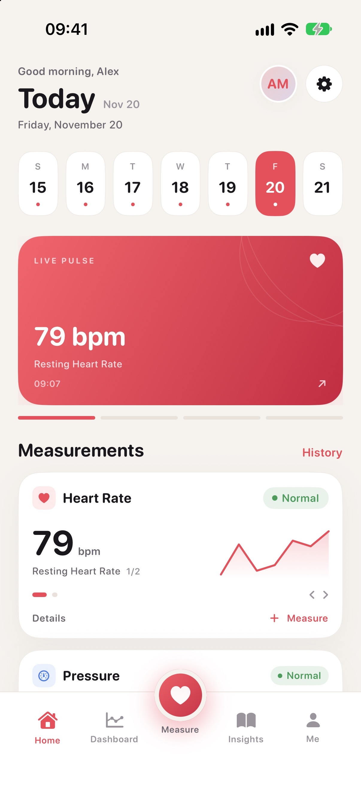

# Heartica

A SwiftUI implementation of the heart-health application described in the supplied
requirements analysis (`com.silverdawn.frostyhill.myst`). The project is generated with
**XcodeGen** and deliberately has no third-party dependencies.



## Requirements

- Xcode 27 or later (the project is verified against Xcode 27.1)
- iOS 17.0+ deployment target, iPhone portrait only
- [XcodeGen](https://github.com/yonaskolb/XcodeGen) 2.46+

## Build and run

```bash
xcodegen generate
open Heartica.xcodeproj
```

Or entirely from the command line:

```bash
xcodebuild -project Heartica.xcodeproj -scheme Heartica \
  -sdk iphonesimulator -configuration Debug \
  -derivedDataPath .build build CODE_SIGNING_ALLOWED=NO

xcrun simctl boot "iPhone 17 Pro"
xcrun simctl install booted .build/Build/Products/Debug-iphonesimulator/Heartica.app
xcrun simctl launch booted com.silverdawn.frostyhill.myst
```

`project.yml` is the source of truth for targets, Info.plist keys, bundle identifier,
orientation and deployment target. Regenerate after changing it.

### Tests

```bash
# Unit tests
xcodebuild test -project Heartica.xcodeproj -scheme Heartica \
  -destination 'platform=iOS Simulator,name=iPhone 17 Pro' \
  -derivedDataPath .build \
  -only-testing:HearticaTests CODE_SIGNING_ALLOWED=NO

# UI smoke suite
xcodebuild test -project Heartica.xcodeproj -scheme Heartica \
  -destination 'platform=iOS Simulator,name=iPhone 17 Pro' \
  -derivedDataPath .build \
  -only-testing:HearticaUITests CODE_SIGNING_ALLOWED=NO
```

The UI suite covers onboarding + post-onboarding, seeded and empty states,
main tabs, dashboard metric details, article reader, journey, history,
pressure logging, settings, reminders, Apple Health, paywall purchase,
premium monthly overview and the full measurement flow.

### Demo launch arguments

The app starts with a clean state and onboarding. For simulator screenshots or a
fast feature tour, these launch arguments are available:

| Argument | Effect |
|---|---|
| `-resetData YES` | Delete the local store before launch |
| `-seedDemo YES` | Seed three weeks of sample measurements and logs when empty |
| `-seedPremium YES` | Mark the demo account as Premium |
| `-onboardingCompleted YES` | Skip pre-onboarding (read-only override) |
| `-postOnboardingCompleted YES` | Skip post-onboarding (read-only override) |
| `-resetOnboarding YES` | Clear the persisted onboarding flags before launch |
| `-skipSplash YES` | Skip the splash animation |
| `-initialTab home\|dashboard\|insights\|me` | Open a tab |
| `-showMeasure YES` | Open the measurement flow |
| `-showLatestMeasurement YES` | Open the newest measurement detail |
| `-showHistory YES`, `-showJourney YES`, `-showSettings YES` | Open a feature |
| `-showMonthly YES`, `-showAppleHealth YES`, `-showPaywall YES` | Open a feature |
| `-showMetricDetail YES` | Open the Health Index detail sheet |
| `-appearanceMode system\|light\|dark` | Override appearance |

Example:

```bash
xcrun simctl launch booted com.silverdawn.frostyhill.myst \
  -resetData YES -seedDemo YES -skipSplash YES \
  -onboardingCompleted YES -postOnboardingCompleted YES
```

## Implemented modules

| Area | What is implemented |
|---|---|
| Startup | Animated splash, first-run routing, force-update screen is not triggered locally (no remote config) |
| Onboarding | Five-page welcome/pulse/log/stress/monitor tour, onboarding premium screen, personalization form, permission education |
| Post-onboarding | Apple Health intro, sync progress, profile review, three quiz questions, animated calculation and four risk blocks |
| Home | Weekly day strip, four-card carousel (pulse, CSI, heart age, premium), heart-rate and pressure/oxygen/glucose cards, measurement history entry, Journey level card, premium banner |
| Measurement | Camera PPG pipeline with red-channel sampling and peak detection, Fast/Standard/Precise modes, calibration + measuring steps, animated pulse UI, camera-denied state, simulator fallback, save and result |
| Results | Nine metric cards, pulse/SDNN/RMSSD/pNN50/energy/stress/health-index thresholds, heart-age card, AI health state, two-part smart comment, context tags, share/retake/delete |
| Dashboard | Highlight strip, six metric cards with sparklines, energy/stress combined card, CSI block, heart-age block, monthly overview entry, chart settings, metric detail with period switching and Swift Charts |
| CSI & heart age | Baevsky-style SI bands, seven-day average, day progress, heart-age calculation from RMSSD and profile, status ranges |
| Insights | Ten categories and 83 articles, Popular collection, generated cover art, story reader with five-second page progress, source and share, read tracking |
| Journey | Twelve chapters, 100 levels, 500 tasks, sequential unlock, real progress checks for counts, days, consistency, context tags, pairs, articles and Apple Health |
| Achievements | Five categories, 21 achievements, 265 tiers, threshold progress, ribbons, detail view |
| Me & profile | Profile card, period statistics (D/W/M/3M/Y) for pulse/HRV/stress/health index/pressure/glucose/oxygen, profile editing with validated fields and photo picker |
| History | Month navigation, day grouping, heart-rate and three manual log types, add/edit/delete, detail and tag display |
| Manual logs | Blood pressure 80–260/40–140, glucose 50–250 mg/dL or 2.7–13.8 mmol/L (18.0 factor, truncated tenths), oxygen 1–100, time and tags |
| Monthly overview | 14 metrics, month calendar with day dots, selected-day average, bar chart, premium promotion overlay |
| Reminders | Six reminder types, daily `UNCalendarNotificationTrigger`, permission handling, list switches, edit/delete |
| Paywall | Premium feature list, weekly/yearly plans, three-day trial toggle, restore, legal links; local demo purchase |
| Apple Health | Connection state, sync-journal of watch readings, monthly grouping, sync action, setup guide |
| Settings | Appearance, reminders, Apple Health, legal pages, restore, contact mail, share, rating, What's New, sample data, reset |
| Data | Codable local store with measurements, pressure/glucose/oxygen logs, tags, reminders, read articles, profile, premium state |

## Architecture

```
Heartica/
  App/            app entry, router, root state, design system
  Models/         domain models, catalogs, JSON store, health/achievement/journey engines
  Services/       PPG camera, notification manager
  Components/     reusable cards, charts, tab bar, layout helpers
  Features/       onboarding, home, measure, dashboard, insights, journey,
                  me, history
```

- `AppStore` is the single source of truth and persists a `PersistedState` snapshot
  to `Application Support/Heartica/store.json`.
- Health metrics are derived in `HealthEngine` from measured NN interval statistics:
  `Health Index = ln(RMSSD)`, energy is normalized ln(RMSSD), stress is an inverse
  SDNN normalization and the CSI uses a Baevsky-style stress-index estimate.
- The measurement flow uses the real back camera when available: frames are sampled
  on a background queue, the red channel mean is tracked, and peak intervals are
  converted to BPM. In the simulator (no camera) or when permission is denied, an
  explicit simulated PPG signal is used and labelled in the UI.
- Journey and achievement progress is computed from real stored data; no fabricated
  unlocks are persisted.

## Verification

- `xcodebuild build` succeeds for the iOS simulator.
- `HearticaTests` covers threshold tables, derived metrics, glucose conversion,
  catalog sizes (10/83 articles, 12/100/500 journey, 21 achievements), persistence
  round-trip, sample data, sequential journey unlock and article progress.
- `HearticaUITests` is a 7-test smoke suite run on the simulator. It caught and
  now guards a real crash: opening a dashboard metric detail constructed
  `DashboardView` just to compute chart points, which triggered
  `EnvironmentObject.error()` because the temporary view had no `AppStore`.
  Metric series now live in `MetricSeries` and take the store explicitly.
- Screenshots from the running app are in [`Screenshots/`](Screenshots):
  onboarding, post-onboarding, home, home (dark), dashboard, health-index detail,
  insights, article reader, journey, history, settings, reminders, achievements,
  paywall, monthly overview, measurement flow, measurement result, measurement
  detail and Apple Health.

## Deliberate limitations

The requirement source is a static analysis of the original app, not its source or
assets. This implementation reproduces the user-visible structure and behavior with
original visuals and content. The following are explicitly simulated or simplified:

- **In-App Purchase / StoreKit**: no products are configured in this environment, so
  the paywall completes a local premium state. There is no receipt validation or
  real subscription management.
- **Apple Health**: the entitlement and real HKHealthStore queries are not enabled;
  the connection, sync states and watch journal are modeled locally and clearly
  labelled as a local sync.
- **Camera measurement**: the real AVFoundation pipeline is implemented, but a
  simulator has no camera. The fallback signal is labelled "Simulated PPG · no camera"
  in the measurement UI. It has not been validated on a physical device here.
- **Remote configuration and analytics**: the original app's 24 remote-config keys,
  A/B paywall variants and analytics stack are out of scope; sensible local defaults
  are used.
- **Insights copy**: the 83 article titles/categories and reader mechanics are
  reproduced, but the original article body copy and 166 illustrations are not in
  the supplied document. Article bodies are original, concise wellness copy and
  covers are generated gradients.
- **Assets**: Lottie/video assets from the IPA are not supplied, so all artwork is
  built from gradients, shapes and SF Symbols.
- **Localization**: the UI is English-only; the original ships 18 `.lproj` bundles.
- **PDF export**: the Me statistics PDF share action is not implemented.
- **Force update / offline popup**: no remote version source is available locally.

These decisions follow the document's explicit "implementation-defined" notes for
unknown values (camera durations, prices, article copy, etc.).
